# Data Model and Synthetic Demo Data

**Document version:** 1.0
**Project stage:** Phase 5 — Data Model, Database Schema and Integrations
**Status:** Proposed logical model and synthetic fixtures. No database or application data service is deployed.
**Related documents:** [System architecture](04_SYSTEM_ARCHITECTURE.md) · [Agent design](05_AGENT_DESIGN.md) · [Workflows and approvals](06_WORKFLOWS_AND_APPROVALS.md) · [Database schema](DATABASE_SCHEMA.md) · [API contracts](API_CONTRACTS.md) · [Integrations](09_INTEGRATIONS.md)

## 1. Scope, conventions, and data classification

The model is designed around the Phase 1–4 control tower, five proposed specialist agents, CAP-controlled adapters, and version-bound human decisions. It separates master, transactional, workflow, AI-generated, communication, and audit data. It is a logical design, not an implemented CAP model or deployed HANA schema.

| Convention | Proposed rule |
|---|---|
| Identifiers | Stable opaque string IDs with entity prefixes in the synthetic fixtures; production key generation remains a CAP/HANA implementation decision. IDs are not credentials. |
| Naming | `camelCase` JSON/API fields; logical entity names in PascalCase; uppercase singular HANA table names and uppercase underscore columns. |
| Time | RFC 3339/ISO 8601 timestamps with explicit UTC offset; synthetic fixtures use `+00:00`. Date-only business dates use `YYYY-MM-DD`. |
| Units | Every measured quantity has an explicit `unit`; mass uses `kg`; finished product quantity uses `tablet`; coverage/delay use production days. |
| Provenance | Material facts carry source/evidence references, `sourceStatus`, `verificationStatus`, `observedAt`, and `dataMode` as appropriate. |
| Synthetic data | Each fixture file is labelled `dataMode: "synthetic"` at its root; individual simulated outcomes use `dataMode: "simulated"`. No real people, contact details, patient records, or operational supplier data are present. |
| Estimates | Store formula/method, input references, unit, assumptions, and an explicit estimate label. Do not model patient-level outcomes. |
| Business status | Persist controlled strings/lookup references; API schemas define allowed values. Do not rely on free text for authorization or workflow state. |
| Record history | Workflow decisions and audit are append-only; operational master/current-state records may be updated with version and audit history. |

### Data classes

- **Master data:** Organization, user, role/permission, supplier and qualification, product/material, facility, warehouse, port, route, customer, and agent catalog.
- **Transactional data:** Inventory positions/batches, purchase orders and lines, shipment/events, production plans/batches/material consumption, customer orders/lines/fulfilments/deliveries.
- **Incident and analytical data:** Disruption, evidence, risk assessment, impact estimate, recovery plan/action.
- **Workflow data:** Approval request and decision, execution record, agent execution, tool invocation, emergency-control request.
- **Communication data:** Voice-call metadata/summary, email draft and delivery record. Do not store full call transcripts by default.
- **Audit data:** Append-only material actions and state transitions with actor, time, references, result, and redaction classification.

## 2. Logical entities and constraints

Notation: **PK** primary key; **FK** foreign key; `!` required; `?` optional. Types are logical JSON/CAP types; see [DATABASE_SCHEMA.md](DATABASE_SCHEMA.md) for proposed HANA mappings. Unless noted, records include `createdAt`, `updatedAt`, and `dataMode`; immutable event records have `recordedAt` and no ordinary update.

### Organization and authorization (master data)

| Entity | Purpose; PK; attributes | Relationships; required / optional; validation and statuses |
|---|---|---|
| **Organization** | Tenant/demo organization; PK `organizationId`; `legalName`, `displayName`, `countryCode`, `city`, `dataMode`. | Parent of users, suppliers-as-counterparties, facilities, warehouses, customers. Name/country required; country is ISO 3166-1 alpha-2; demo organization is explicitly fictional. |
| **User** | Human application identity reference; PK `userId`; `organizationId`, `roleId`, `displayName`, `accountState`, `isSyntheticIdentity`. | FK Organization, Role. Display name and role required; do not store passwords/tokens here. `accountState`: `active`, `disabled`, `pending`. Fixtures use role-label aliases, not real persons. |
| **Role** | One of the seven established roles; PK `roleId`; `name`, `description`. | Referenced by User and RolePermission. Names unique and exactly match Phase 2 roles. |
| **Permission** | Named permission/action capability; PK `permissionId`; `resource`, `action`, `scopeDescription`. | Referenced by RolePermission. Permission definitions are descriptive; CAP authorization remains server-enforced. |
| **RolePermission** | Role-permission association; composite PK (`roleId`, `permissionId`); `grantState`, `scope`. | FKs Role and Permission. Proposed/limited states only; pending access decisions are not grants. Final approval policy remains explicit and does not derive from arbitrary permission rows. |

### Supply chain master data

| Entity | Purpose; PK; attributes | Relationships; required / optional; validation and statuses |
|---|---|---|
| **Supplier** | Candidate/source supplier; PK `supplierId`; `organizationId`, `name`, `countryCode`, `city`, `supplierState`, `sourceStatus`, `dataMode`. | FK Organization. Candidate is not qualified merely by existing. `supplierState`: `candidate`, `active_demo`, `qualified_demo_only`, `suspended`, `inactive`; demo-only states are never real-world claims. |
| **SupplierStatusEvent** | Immutable supplier state transition; PK `supplierStatusEventId`; `supplierId`, `previousState`, `newState`, `changedAt`, `reason`, `dataMode`. | FK Supplier. Append-only history; state changes require authorized workflow and audit, and a state event is not qualification evidence. |
| **SupplierQualification** | Qualification snapshot for a supplier/product and checklist dimension; PK `qualificationId`; `supplierId`, `productId`, `checkType`, `checkState`, `evidenceRef`, `reviewedBy`, `reviewedAt`, `validUntil`, `dataMode`. | FK Supplier, Product, User reviewer. One current row per supplier/product/check type; six required checks are quality, regulatory, quantity, capacity, supplier confirmation, delivery. `checkState`: `unverified`, `verified`, `failed`, `expired`; verified synthetic fixtures must cite synthetic evidence and remain demo-only. |
| **Product** | Finished medicine; PK `productId`; `organizationId`, `productName`, `strength`, `dosageForm`, `baseUnit`, `productState`, `dataMode`. | FK Organization. Strength/unit explicit; demo product is fictional Paracetamol 500 mg tablet. `productState`: `active`, `inactive`. |
| **Material** | API, excipient, or packaging material; PK `materialId`; `materialName`, `materialType`, `baseUnit`, `materialState`, `dataMode`. | Used by BOM, SupplierQualification, Inventory, PurchaseOrderLine, ProductionPlan. Type: `api`, `excipient`, `packaging`, `other`; no unsupported regulated claims. |
| **ProductMaterial** | Product bill-of-material usage; composite PK (`productId`, `materialId`, `effectiveFrom`); `quantityPerBaseUnit`, `unit`, `effectiveTo`. | FKs Product and Material. Quantity positive, units compatible; effective dates do not overlap for same product/material. |
| **Facility** | Manufacturing site; PK `facilityId`; `organizationId`, `facilityName`, `city`, `countryCode`, `facilityState`, `dataMode`. | FK Organization. `facilityState`: `active`, `inactive`, `under_review`; no certification implied. |
| **Warehouse** | Storage location; PK `warehouseId`; `organizationId`, `facilityId`, `warehouseName`, `city`, `countryCode`, `warehouseType`, `warehouseState`, `dataMode`. | FK Organization and optional Facility. `warehouseType`: `raw_material`, `finished_goods`, `distribution`, `other`. |
| **Port** | Route waypoint; PK `portId`; `portName`, `city`, `countryCode`, `portType`, `dataMode`. | Used by Route and ShipmentEvent; `portType`: `sea`, `air`, `land`, `other`. Fictional fixtures identify scenario locations only. |
| **Route** | Ordered logistics path; PK `routeId`; `routeName`, `originRef`, `destinationRef`, `waypoints`, `modeSummary`, `routeState`, `dataMode`. | References supplier/facility/port/warehouse IDs using typed refs; no external route API required. `routeState`: `planned`, `active_demo`, `under_evaluation`, `inactive`. |
| **Customer** | Fictional customer organization; PK `customerId`; `organizationId`, `customerName`, `customerType`, `city`, `countryCode`, `customerState`, `dataMode`. | FK Organization; parent of CustomerOrder. `customerType`: `hospital`, `medical_distributor`, `export_importer`; no contact/PII required. |
| **DemandAssumption** | Synthetic demand input for an impact calculation; PK `assumptionId`; `customerId`?, `productId`, `dailyDemand`, `unit`, `dataMode`. | Optional FK Customer, FK Product. Non-negative quantity with explicit unit and scenario provenance; aggregate totals must reconcile to their included customers. Not actual consumption data. |

### Transactional data

| Entity | Purpose; PK; attributes | Relationships; required / optional; validation and statuses |
|---|---|---|
| **InventoryPosition** | Quantity at a location/time; PK `inventoryId`; `materialId`, `warehouseId`, `batchId`, `quantity`, `unit`, `asOf`, `coverageDays`, `sourceStatus`, `dataMode`. | FKs Material, Warehouse, optional InventoryBatch. Quantity non-negative; unit compatible; coverage is a derived, scenario-labelled value and is not additive across locations. |
| **InventoryBatch** | Lot-level stock/expiry; PK `batchId`; `materialId`, `lotCode`, `quantity`, `unit`, `manufacturedOn`, `expiresOn`, `qualityState`, `sourceStatus`, `dataMode`. | FK Material; referenced by InventoryPosition, production consumption, movements. Quantity non-negative; expiry after manufacture; `qualityState`: `pending`, `released_demo`, `quarantined`, `expired`. |
| **PurchaseOrder** | Supplier order header; PK `purchaseOrderId`; `supplierId`, `orderedAt`, `currency`, `orderState`, `approvalRequestId`, `sourceStatus`, `dataMode`. | FK Supplier and optional ApprovalRequest. Currency ISO 4217; `orderState`: `draft`, `approved`, `sent_simulated`, `open`, `part_received`, `received`, `cancelled`. |
| **PurchaseOrderLine** | Ordered material/quantity; PK `purchaseOrderLineId`; `purchaseOrderId`, `materialId`, `quantity`, `unit`, `unitPrice`?, `lineState`. | FK PurchaseOrder, Material. Positive quantity; optional price/currency handled without inventing commercial terms; `lineState`: `open`, `part_received`, `received`, `cancelled`. |
| **Shipment** | Supplier/customer logistics movement; PK `shipmentId`; `purchaseOrderId`?, `routeId`, `carrierRef`?, `originRef`, `destinationRef`, `plannedArrival`, `revisedArrival`?, `actualArrival`?, `shipmentState`, `sourceStatus`, `dataMode`. | FK Route, optional PurchaseOrder; parent of ShipmentEvent. Date order validated; status includes `planned`, `in_transit`, `delayed`, `arrived`, `cancelled`, `unknown`. ETA is never fabricated. |
| **ShipmentEvent** | Immutable shipment milestone/source update; PK `shipmentEventId`; `shipmentId`, `eventType`, `eventAt`, `description`, `sourceRef`, `sourceStatus`, `dataMode`. | FK Shipment. Event order/time checked; `eventType`: `created`, `departed`, `delay_reported`, `port_arrival`, `customs`, `delivered`, `status_check`. |
| **ProductionPlan** | Planned facility/product output and constraints; PK `productionPlanId`; `facilityId`, `productId`, `periodStart`, `periodEnd`, `plannedQuantity`, `unit`, `planState`, `approvalRequestId`?, `dataMode`. | FK Facility, Product, optional ApprovalRequest. Period valid, quantities non-negative; changes remain proposals until approval. |
| **ProductionBatch** | Actual/demo production lot; PK `productionBatchId`; `productionPlanId`, `batchCode`, `quantity`, `unit`, `startedAt`, `completedAt`?, `batchState`, `dataMode`. | FK ProductionPlan; parent of ProductionConsumption. `batchState`: `planned`, `in_progress`, `completed_simulated`, `held`, `cancelled`. |
| **ProductionConsumption** | Material consumed by a production batch; PK `consumptionId`; `productionBatchId`, `materialId`, `inventoryBatchId`, `quantity`, `unit`, `consumedAt`, `dataMode`. | FKs ProductionBatch, Material, InventoryBatch. Quantity non-negative and unit-compatible; total consumption cannot exceed received batch quantities. |
| **CustomerOrder** | Customer demand/order header and lines; PK `customerOrderId`; `customerId`, `orderedAt`, `requiredDeliveryDate`, `orderState`, `currency`?, `dataMode`. | FK Customer; parent of OrderLine and OrderFulfilment. `orderState`: `open`, `at_risk`, `part_fulfilled`, `fulfilled`, `cancelled`; dates and quantities are synthetic fixture values. |
| **OrderLine** | Product/material quantity requested; PK `orderLineId`; `customerOrderId`, `productId`, `quantity`, `unit`, `lineState`. | FK CustomerOrder, Product. Positive quantity; `lineState`: `open`, `allocated_proposed`, `allocated_approved`, `part_fulfilled`, `fulfilled`, `cancelled`. |
| **OrderFulfilment** | Approved/observed allocation to order line; PK `fulfilmentId`; `orderLineId`, `quantity`, `warehouseId`, `fulfilmentState`, `approvalRequestId`?, `dataMode`. | FK OrderLine, Warehouse, optional ApprovalRequest. Fulfilled totals cannot exceed order line quantity; reallocation requires protected approval. |
| **Delivery** | Despatch/receipt event for fulfilment; PK `deliveryId`; `fulfilmentId`, `shipmentId`?, `quantity`, `unit`, `despatchedAt`?, `deliveredAt`?, `deliveryState`, `sourceStatus`, `dataMode`. | FK OrderFulfilment and optional Shipment. `deliveryState`: `planned`, `in_transit`, `delivered_simulated`, `delayed`, `failed`, `unknown`. |

### Incident, analysis, workflow, AI, communication, and audit data

| Entity | Purpose; PK; attributes | Relationships; required / optional; validation and statuses |
|---|---|---|
| **Disruption** | Incident record; PK `disruptionId`; `organizationId`, `title`, `productId`, `supplierId`, `shipmentId`?, `detectedAt`, `reportedDelayDays`, `incidentState`, `sourceStatus`, `dataMode`. | FK Organization, Product, Supplier, optional Shipment. `incidentState`: `monitoring`, `recovery_in_progress`, `recovered`, `closed`; synthetic close requires documented demo evidence and human decision. |
| **Evidence** | Source/artifact reference and verification metadata; PK `evidenceId`; `subjectType`, `subjectId`, `evidenceType`, `sourceLabel`, `sourceStatus`, `observedAt`, `verifiedBy`?, `verifiedAt`?, `dataMode`. | Polymorphic subject reference validated by CAP; no requirement to store raw document. Verification event is attributable; synthetic evidence cannot prove real-world status. |
| **RiskAssessment** | Risk snapshot; PK `riskAssessmentId`; `disruptionId`, `assessedAt`, `riskType`, `severity`, `summary`, `method`, `inputRefs`, `assessmentState`, `dataMode`. | FK Disruption; references Evidence/Inventory/Orders. Severity `low`, `medium`, `high`, `critical`, `unknown`; estimates disclose method and inputs. |
| **ImpactEstimate** | Aggregate synthetic operational/customer availability estimate; PK `impactEstimateId`; `disruptionId`, `estimateType`, `value`, `unit`, `method`, `inputRefs`, `assumptionRefs`, `estimateLabel`, `dataMode`, `calculatedAt`. | FK Disruption; no patient-level records. `estimateLabel` must explicitly contain synthetic estimate; estimate type constrained. |
| **RecoveryPlan** | Versioned response plan; PK `recoveryPlanId`; `disruptionId`, `version`, `planState`, `summary`, `allocationPolicyRef`?, `createdBy`, `createdAt`, `dataMode`. | FK Disruption, User; one active version per incident; `planState`: `draft`, `submitted`, `approved_in_part`, `executing`, `monitoring`, `completed`, `cancelled`. |
| **RecoveryAction** | Proposed or executed plan step; PK `recoveryActionId`; `recoveryPlanId`, `actionType`, `actionState`, `targetRef`, `proposalVersion`, `executionRef`?, `dataMode`. | FK RecoveryPlan; ApprovalRequest references the action, avoiding a bidirectional FK cycle. `actionType` maps to the eight protected categories or non-protected analysis; `actionState`: `draft`, `pending_approval`, `approved`, `executing`, `executed_unverified`, `verified`, `rejected`, `failed`, `cancelled`. |
| **ApprovalRequest** | Version-bound human decision request; PK `approvalRequestId`; `recoveryActionId`, `actionCategory`, `proposalVersion`, `submittedBy`, `submittedAt`, `approverRole`, `requestState`, `idempotencyKey`. | FK RecoveryAction, User; unique idempotency key and action/version; protected action requires Supply Chain Head final decision. States per Phase 4 lifecycle. |
| **ApprovalDecision** | Immutable human outcome; PK `approvalDecisionId`; `approvalRequestId`, `proposalVersion`, `decision`, `decisionBy`, `decidedAt`, `reason`?, `decisionEvidenceRefs`. | FK ApprovalRequest and User. Decision by authenticated human; `approve`, `reject`, `request_changes`, `escalate`, `revoke`; approved version must match exactly. |
| **Agent** | Proposed agent catalog; PK `agentId`; `agentName`, `agentRole`, `agentState`, `promptVersion`, `isProposed`, `dataMode`. | Referenced by AgentExecution; names match Phase 4 A-01..A-05. `agentState`: `available_demo`, `paused`, `stopped`, `failed`; not proof of running AI. |
| **AgentExecution** | One bounded task execution; PK `agentExecutionId`; `agentId`, `disruptionId`, `taskId`, `startedAt`, `completedAt`?, `executionState`, `summary`, `evidenceRefs`, `failureCode`?, `dataMode`. | FK Agent and Disruption. `executionState`: `queued`, `running`, `succeeded`, `partial`, `failed`, `timed_out`, `cancelled`. No chain-of-thought storage. |
| **ToolInvocation** | One scoped tool call/result; PK `toolInvocationId`; `agentExecutionId`?, `toolName`, `requestRef`, `startedAt`, `completedAt`?, `resultState`, `sourceStatus`, `idempotencyKey`?, `dataMode`. | FK AgentExecution, optional; CAP authorization context required, no secrets/raw unrestricted payload. |
| **VoiceCall** | Human-initiated call metadata and summary; PK `voiceCallId`; `disruptionId`, `initiatedBy`, `recipientRole`, `purpose`, `consentState`, `callState`, `summary`, `verificationState`, `startedAt`?, `endedAt`?, `dataMode`. | FK Disruption, User; no personal phone numbers/transcript in demo. Responses remain unverified pending corroboration. |
| **EmailDraft** | Versioned email content and approvals; PK `emailDraftId`; `disruptionId`, `recipientRef`, `purpose`, `content`, `contentVersion`, `draftState`, `createdBy`, `createdAt`, `approvalRequestId`?, `dataMode`. | FK Disruption, User, optional ApprovalRequest. Content edits increment version; no sending without applicable human approval. |
| **CommunicationDelivery** | Email/call dispatch outcome; PK `communicationDeliveryId`; `emailDraftId`?, `voiceCallId`?, `deliveryState`, `providerStatusRef`?, `attemptedAt`?, `completedAt`?, `dataMode`. | FK EmailDraft or VoiceCall; exactly one parent; simulated outcomes cannot be presented as real external delivery. |
| **SuspiciousActivityAlert** | Neutral evidence-linked alert; PK `alertId`; `disruptionId`, `subjectType`, `subjectId`, `alertType`, `neutralRationale`, `evidenceRefs`, `alertState`, `holdState`, `createdAt`, `dataMode`. | FK Disruption; alert types cover duplicate invoice, supplier bank change, duplicate PO, unusual pricing, inventory manipulation, supplier change. Only authorized workflow may hold transaction; never assert guilt. |
| **AuditEvent** | Append-only record of material action/state; PK `auditEventId`; `eventType`, `actorType`, `actorId`, `role`, `occurredAt`, `recordedAt`, `resourceType`, `resourceId`, `disruptionId`?, `correlationId`, `proposalVersion`?, `resultState`, `sourceRefs`, `redactionState`, `dataMode`. | FK actor/incident where available. Append-only; corrections create linked events. Exclude credentials, secrets, and unnecessary transcript/content. |

## 3. ER diagram

This diagram summarizes core relationships; reference fields and junction entities are detailed above. Dashed association denotes versioned workflow/audit references rather than permission to mutate.

```mermaid
erDiagram
    ORGANIZATION ||--o{ USER : employs
    ROLE ||--o{ USER : assigns
    ROLE ||--o{ ROLE_PERMISSION : grants
    PERMISSION ||--o{ ROLE_PERMISSION : describes
    ORGANIZATION ||--o{ SUPPLIER : records
    SUPPLIER ||--o{ SUPPLIER_STATUS_EVENT : changes
    SUPPLIER ||--o{ SUPPLIER_QUALIFICATION : evaluated_by
    PRODUCT ||--o{ SUPPLIER_QUALIFICATION : qualified_for
    PRODUCT ||--o{ PRODUCT_MATERIAL : contains
    MATERIAL ||--o{ PRODUCT_MATERIAL : used_in
    ORGANIZATION ||--o{ FACILITY : operates
    FACILITY ||--o{ WAREHOUSE : contains
    MATERIAL ||--o{ INVENTORY_POSITION : stocked_as
    WAREHOUSE ||--o{ INVENTORY_POSITION : holds
    INVENTORY_BATCH ||--o{ INVENTORY_POSITION : counted_in
    SUPPLIER ||--o{ PURCHASE_ORDER : receives
    PURCHASE_ORDER ||--|{ PURCHASE_ORDER_LINE : includes
    MATERIAL ||--o{ PURCHASE_ORDER_LINE : ordered
    PURCHASE_ORDER ||--o{ SHIPMENT : fulfilled_by
    ROUTE ||--o{ SHIPMENT : follows
    SHIPMENT ||--o{ SHIPMENT_EVENT : records
    FACILITY ||--o{ PRODUCTION_PLAN : runs
    PRODUCT ||--o{ PRODUCTION_PLAN : produces
    PRODUCTION_PLAN ||--o{ PRODUCTION_BATCH : creates
    PRODUCTION_BATCH ||--o{ PRODUCTION_CONSUMPTION : consumes
    INVENTORY_BATCH ||--o{ PRODUCTION_CONSUMPTION : supplies
    MATERIAL ||--o{ PRODUCTION_CONSUMPTION : consumed_as
    ORGANIZATION ||--o{ CUSTOMER : serves
    CUSTOMER ||--o{ CUSTOMER_ORDER : places
    CUSTOMER ||--o{ DEMAND_ASSUMPTION : has
    PRODUCT ||--o{ DEMAND_ASSUMPTION : estimates
    CUSTOMER_ORDER ||--|{ ORDER_LINE : contains
    PRODUCT ||--o{ ORDER_LINE : requested
    ORDER_LINE ||--o{ ORDER_FULFILMENT : fulfilled_by
    ORDER_FULFILMENT ||--o{ DELIVERY : delivered_as
    ORGANIZATION ||--o{ DISRUPTION : monitors
    PRODUCT ||--o{ DISRUPTION : affected
    SUPPLIER ||--o{ DISRUPTION : source
    DISRUPTION ||--o{ RISK_ASSESSMENT : assessed
    DISRUPTION ||--o{ IMPACT_ESTIMATE : estimates
    DISRUPTION ||--o{ RECOVERY_PLAN : recovers_through
    RECOVERY_PLAN ||--|{ RECOVERY_ACTION : contains
    RECOVERY_ACTION ||--o{ APPROVAL_REQUEST : requires
    APPROVAL_REQUEST ||--o{ APPROVAL_DECISION : records
    AGENT ||--o{ AGENT_EXECUTION : performs
    DISRUPTION ||--o{ AGENT_EXECUTION : scopes
    AGENT_EXECUTION ||--o{ TOOL_INVOCATION : invokes
    DISRUPTION ||--o{ VOICE_CALL : coordinates
    DISRUPTION ||--o{ EMAIL_DRAFT : communicates
    DISRUPTION ||--o{ SUSPICIOUS_ACTIVITY_ALERT : flags
    DISRUPTION o|--o{ AUDIT_EVENT : contextualizes
```

## 4. Synthetic fixture catalog and scenario timeline

The machine-readable records in [`data/synthetic/`](../data/synthetic/) are a **fictional, self-contained demonstration fixture**; they are not sourced from BharatMed, a real supplier/customer, SAP, or a live integration. Static timestamps describe a demonstration timeline, not current live status.

| Demo day / timestamp | Event |
|---|---|
| 2026-08-15 (pre-incident) | Fictional primary supplier purchase order and planned shipment already exist, establishing the synthetic baseline before the disruption. |
| 2026-09-01 (Day 0) | Synthetic incident begins on the original ETA of the main shipment. 1,000 kg API at 50 kg/production day gives 20 days coverage through 2026-09-21. |
| 2026-09-01 | Supplier reports revised arrival 2026-10-01, a 30-day delay from the original 2026-09-01 ETA. `30 - 20 = 10` production days of potential gap (2026-09-21 to 2026-10-01) without recovery. |
| 2026-09-02 | Five specialists prepare bounded assessments; deterministic calculation and impact estimate remain synthetic. |
| 2026-09-02 to 2026-09-03 | Six backup-supplier verification dimensions are recorded as passed **for this synthetic scenario only**, with synthetic evidence references. |
| 2026-09-03 | Recovery-plan action to buy backup API is approved by synthetic Supply Chain Head identity; the approved proposal version is recorded. |
| 2026-09-03 to 2026-09-05 | Simulated purchase and receipt of 500 kg (10 production days) are recorded; no real supplier order is placed. |
| 2026-10-01 | Original delayed shipment is marked delivered in the synthetic fixture; simulated status only. |
| 2026-10-15 | Five synthetic customer orders are shown delivered through simulated fulfilment/delivery records. |
| 2026-11-02 | Supply Chain Head records a synthetic human closure decision after receipt, production, shipment, and order evidence are represented. |

### Quantity and estimate basis

- API inventory snapshot: **1,000 kg** / **50 kg per production day** = **20 production days**.
- Original ETA 2026-09-01; revised ETA 2026-10-01 = **30 calendar days late**.
- Scenario's potential gap calculation follows the Phase 1/2 business rule: **30-day delay − 20-day coverage = 10 potential production days**, from 2026-09-21 to 2026-10-01 if there is no recovery. It is an exposure estimate, not proof of a real shortage.
- Backup supplier reported stock: **500 kg** = **10 production days** using the same synthetic 50 kg/day assumption. Successful checks and approval appear in the fixture, but are valid only inside the synthetic demo.
- Customer demand assumptions are synthetic and aggregate to 25,000 tablets/day. Potential 10-day exposure can be expressed as 250,000 tablets of customer availability risk; it is **not a count of patients or an actual patient impact**.
- No placeholder `[X]` values remain in fixtures. Every quantity has a unit, every order is linked to a fictional customer and product, and all actions are non-live simulations.

The allocation policy is represented by `POLICY-ALLOC-001` with status `proposed`; the proposed healthcare-first balanced rule is not applied as an irreversible policy or used to claim an approved reallocation.

## 5. Data ownership, validation, and maintenance

CAP is the logical system of record for application identifiers, references, proposal/approval state, and audit linkage. External or simulated adapters own the status/provenance of their returned source observations. AI-generated records are attributed to an agent execution and cannot overwrite source facts. HANA persistence is planned, not connected.

Machine-readable draft-2020-12 JSON Schemas live in [`data/schemas/`](../data/schemas/). A schema change requires a version update, backward-compatibility review, fixture migration/validation, and synchronization with [DATABASE_SCHEMA.md](DATABASE_SCHEMA.md) and [API_CONTRACTS.md](API_CONTRACTS.md). Cross-record foreign-key and business-invariant checks are additional to JSON Schema validation.

## 6. Open data decisions

Physical table names/types, primary-key strategy, tenant isolation, user identity mapping, evidence/document retention, audit immutability and retention, source-system identifiers, units/conversion policy, exact formula versioning, and final customer-allocation policy remain design decisions. This proposal must not be interpreted as a deployed database or real operational data.
