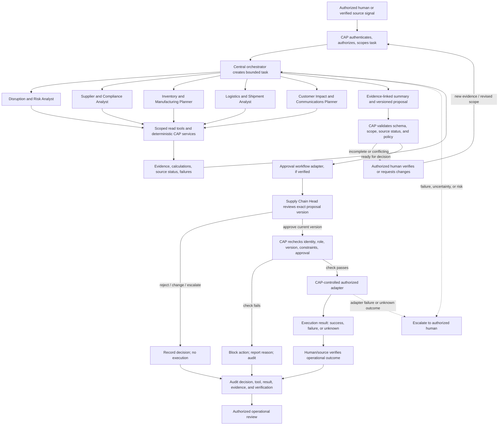

# Proposed Agent and Approval Workflow

**Status:** Conceptual Phase 4 proposal. Agents, workflow engine, APIs, integrations, and execution are not implemented or verified.
**Related documents:** [Agent design](../05_AGENT_DESIGN.md) · [Workflows and approvals](../06_WORKFLOWS_AND_APPROVALS.md) · [Security and audit](../07_SECURITY_AND_AUDIT.md)

The specialist roles and approval adapter are proposed. A recommendation, workflow submission, and approval are separate states. The Supply Chain Head is final approver for the eight protected action categories. Only CAP may dispatch an approved, current proposal after its precondition checks; agents do not approve or directly execute protected actions. An unknown adapter outcome must be reconciled before retry. Audit technology and integration status remain unverified.
