# Supply Chain Flow Diagram

**Status:** Synthetic demonstration scenario; this diagram does not represent live supplier, shipment, inventory, customer, or patient data.
**Related documents:** [Demonstration scenario](../02_DEMO_SCENARIO.md) · [System architecture](../04_SYSTEM_ARCHITECTURE.md) · [Functional requirements](../03_FUNCTIONAL_REQUIREMENTS.md) · [User journeys](../USER_JOURNEYS.md)

```mermaid
flowchart LR
    subgraph PHYSICAL["Physical supply chain — synthetic demonstration"]
        CN[Chinese API supplier<br/>Suzhou / Shanghai region]
        SH[Shanghai Port]
        NH[Nhava Sheva Port<br/>India]
        HYD[Hyderabad factory<br/>Paracetamol manufacturing]
        WH[Warehouses<br/>synthetic locations]
        HOSP[Hospital A<br/>Hyderabad]
        HOSB[Hospital B<br/>Bengaluru]
        DIST[Medical Distributor<br/>Mumbai]
        NAI[Export Importer A<br/>Nairobi]
        LON[Export Importer B<br/>London]
        BACKUP[Potential Hyderabad API supplier<br/>reported 10 production days<br/>subject to verification]
        PROD[Finished medicine<br/>customer fulfilment]

        CN --> SH --> NH --> HYD
        WH --> HOSP
        WH --> HOSB
        WH --> DIST
        WH --> NAI
        WH --> LON
        BACKUP -->|candidate supply; not confirmed| HYD
        HYD --> PROD --> WH
    end

    subgraph DISRUPTION["Disruption and exposure — synthetic scenario"]
        EVENT[Supplier factory disruption<br/>reported shipment delay: 30 days]
        COVER[API inventory coverage:<br/>20 production days]
        GAP[Potential supply gap:<br/>30 − 20 = 10 days<br/>not a confirmed shortage]
        CHECK[Backup stock verification:<br/>quality, regulatory, quantity,<br/>capacity, supplier, delivery]
        EVENT -.->|affects planned shipment| CN
        EVENT --> COVER --> GAP
        BACKUP -.-> CHECK
        CHECK -.->|only verified stock may inform plan| HYD
    end

    subgraph DECISION["AI monitoring and human decision support — conceptual"]
        DATA[Authorized source records<br/>and synthetic inputs]
        CAP[SAP CAP backend<br/>validation and access control]
        ORCH[Central AI orchestrator]
        AGENTS[Specialized agents<br/>exact roles pending]
        REC[Analysis and proposed<br/>recovery options]
        APPROVAL[Supply Chain Head<br/>human approval]
        EXEC[Approved execution<br/>and audit outcome]
        AUDIT[Audit history]

        DATA --> CAP --> ORCH --> AGENTS --> REC
        REC -->|proposal only| CAP
        CAP -->|protected action review| APPROVAL
        APPROVAL -->|approved current proposal only| EXEC
        EXEC --> AUDIT
        REC --> AUDIT
        APPROVAL --> AUDIT
    end

    CN -.->|shipment and supplier status, if available| DATA
    HYD -.->|inventory and production status| DATA
    WH -.->|stock and fulfilment status| DATA
    HOSP -.->|synthetic order/delivery records| DATA
    HOSB -.->|synthetic order/delivery records| DATA
    DIST -.->|synthetic order/delivery records| DATA
    NAI -.->|synthetic order/delivery records| DATA
    LON -.->|synthetic order/delivery records| DATA
    EXEC -.->|approved operational changes only| HYD
    EXEC -.->|approved fulfilment changes only| WH
```

Solid arrows in the first subgraph represent the synthetic physical product path: China → Shanghai Port → Nhava Sheva Port → Hyderabad manufacturing → warehouses → hospital, distributor, and export customers. The backup supplier is a candidate source, not confirmed supply. Dashed arrows represent disruption effects or information/decision-support relationships; they do not imply a verified live integration. The scenario uses a 30-day delay and 20 days of coverage, yielding a 10-day **potential** gap. AI analyzes authorized records and prepares recovery options; protected operational changes reach execution only after Supply Chain Head approval and are audited. All scenario organizations and records are fictional.
