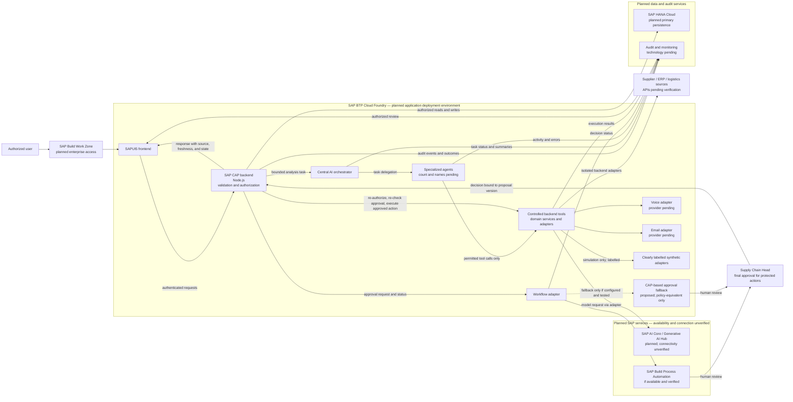

# System Architecture Diagram

**Status:** Conceptual target architecture; service connectivity and implementation are unverified.
**Related documents:** [System architecture](../04_SYSTEM_ARCHITECTURE.md) · [Technology stack](../TECH_STACK.md) · [Integration architecture](../INTEGRATION_ARCHITECTURE.md)

The SAPUI5 client communicates with the SAP CAP backend; CAP owns authorization, data access, approval enforcement, external adapters, and audit recording. The orchestrator coordinates bounded specialist-agent work and uses controlled backend tools; neither agent tool access nor model output grants authority. A protected action is executed only after the Supply Chain Head approves the current proposal version and CAP revalidates the request. SAP services and external providers shown as planned are not claimed connected. Simulated adapters are isolated and labelled. SAP BTP Cloud Foundry is the planned environment, not a confirmed deployment.
